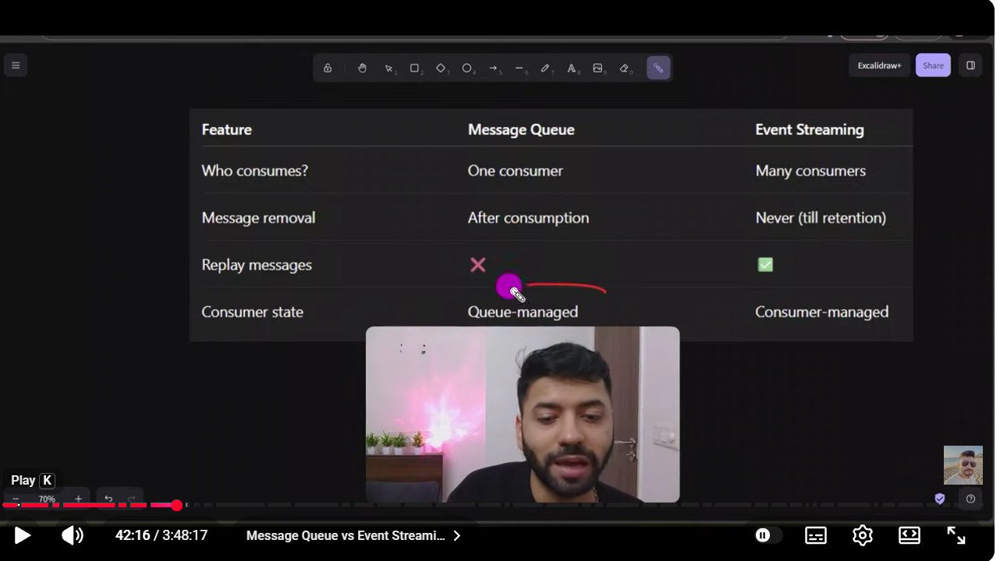

# kafka
kafka learnings

Here are **simple, interview-ready definitions in English** for all the Kafka fundamentals. You can directly use these answers in your Java Backend Developer interview.

## **1. What is Apache Kafka?**

"Apache Kafka is a distributed event streaming platform used for building real-time data pipelines and asynchronous communication between microservices. It provides high throughput, scalability, fault tolerance, and message durability."

## **2. Why do we use Kafka?**

"Kafka is used for asynchronous communication between microservices. It helps services communicate without direct dependency, handles large volumes of messages, provides scalability and fault tolerance, and supports real-time event processing."

## **3. What is a Producer?**

"A Kafka Producer is an application or service that publishes messages or events to Kafka topics."

**Example:** Order Service publishes an OrderCreated event to Kafka.

## **4. What is a Consumer?**

"A Kafka Consumer is an application or service that subscribes to Kafka topics and consumes messages published by producers."

**Example:** Payment Service consumes the OrderCreated event and processes the payment.

## **5. What is a Broker?**

"A Kafka Broker is a Kafka server responsible for storing messages, managing partitions, and serving producer and consumer requests."

## **6. What is a Topic?**

"A Topic is a logical channel or category in Kafka where messages are published and stored. Producers publish messages to topics, and consumers subscribe to topics to receive those messages."

**Example:** order-topic, payment-topic.

## **7. What is a Partition?**

"A Partition is a division of a Kafka topic that allows messages to be distributed across multiple brokers and processed in parallel, improving scalability and throughput."

## **8. What is an Offset?**

"An Offset is a unique sequential identifier assigned to each message within a Kafka partition. It helps consumers track their reading position and manage message consumption."

## **Quick revision – Remember these definitions**

| Concept   | One-line definition                  |
| --------- | ------------------------------------ |
| Kafka     | Distributed event streaming platform |
| Producer  | Publishes messages                   |
| Consumer  | Consumes messages                    |
| Broker    | Kafka server                         |
| Topic     | Logical message category             |
| Partition | Division of a topic                  |
| Offset    | Message position in a partition      |

## **Interview practice**

Try answering this question without looking at the answer:

**Interviewer:** What is the difference between a Topic and a Partition in Kafka?

Type your answer in your own words. I'll correct it and give you a senior-level interview answer.